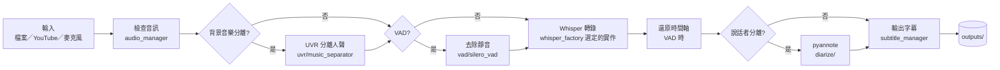
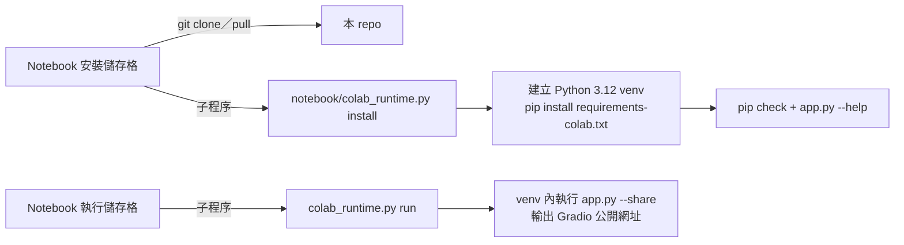

# Whisper-WebUI
A Gradio-based browser interface for [Whisper](https://github.com/openai/whisper). You can use it as an Easy Subtitle Generator!

## 程式碼來源與本次修改

本專案衍生自 [jhj0517/Whisper-WebUI](https://github.com/jhj0517/Whisper-WebUI)，
原作者為 [jhj0517](https://github.com/jhj0517)。本次修改以原專案提交
[`c3bb3b1`](https://github.com/jhj0517/Whisper-WebUI/commit/c3bb3b18e959826b28b1192486a8d5b361b6a4e0)
為基礎；原有功能、程式碼及大部分文件來自原專案，保留原專案的 [LICENSE](LICENSE)。
此衍生版本維護於 [joelhoty/Whisper_WebUI](https://github.com/joelhoty/Whisper_WebUI)。

本次修改（2026-10-08，提交 [`6e35810`](https://github.com/joelhoty/Whisper_WebUI/commit/6e35810d666bc7338deacac888ce9c6cb90e92c7)）
針對 Colab 安裝與啟動的相容性問題：

- 將應用程式依賴集中至 `requirements-common.txt`，讓 Colab 與其他安裝方式共用版本設定。
- 新增 Colab 安裝與啟動程式，使用獨立 `venv`；若 Notebook 核心的 Python 版本超出支援範圍，另行建立 Python 3.12 環境。
- 配對 CUDA 12.6 的 PyTorch 2.8.0、TorchAudio 2.8.0 與 TorchVision 0.23.0，並限制 NumPy、pyannote 等相依套件版本。
- 對 Whisper 的隔離建置環境套用 `setuptools<82`，處理 `pkg_resources` 缺失問題；安裝失敗時停止，並在完成前檢查依賴與啟動匯入。
- Notebook 預設下載本 repo，可指定其他 repo／分支或使用已上傳的專案；重跑時沿用既有 checkout。
- 修正 `insanely-fast-whisper` 選項、以參數清單傳遞啟動設定、優先載入虛擬環境的 CUDA 函式庫，並在掛載 Drive 時備份既有輸出。
- 新增 Colab 啟動流程與 Gradio／i18n 回歸測試，以及對應的 GitHub Actions 檢查。

相關原專案回報：[套件建置失敗 #628](https://github.com/jhj0517/Whisper-WebUI/issues/628)、
[TorchAudio API 不相容 #606](https://github.com/jhj0517/Whisper-WebUI/issues/606)、
[Colab i18n 啟動錯誤 #588](https://github.com/jhj0517/Whisper-WebUI/issues/588)。

後續修改（2026-10-20）：

- Notebook 將子程序輸出轉送到儲存格，讓安裝錯誤與 Gradio 公開網址可見；重跑時先 `git pull` 既有 checkout。
- 覆寫 Colab 核心傳入的 `MPLBACKEND`，避免虛擬環境匯入 matplotlib 失敗。
- 限制 `av<19`：PyAV 19 移除 `av.open()` 的 `metadata_errors` 參數，`faster-whisper 1.1.1` 解碼音訊時會失敗。
- 原本從原作者 GitHub 安裝的 `openai-whisper`（jhj0517-whisper）、`uvr`、`pyrubberband`，
  改為從 fork 至 [joelhoty](https://github.com/joelhoty) 的 repo 固定 commit 建置 wheel，
  發布於 [`deps-v2` Release](https://github.com/joelhoty/Whisper_WebUI/releases/tag/deps-v2)，
  並以 sha256 驗證；來源 commit 與授權列於 Release 說明。

**驗證狀態：已在 Google Colab（T4、Python 3.13 核心）完成安裝、依賴檢查與啟動 Gradio 公開網址。**
`av<19` 已在本機以 Python 3.12 驗證 `faster-whisper` 可解碼音訊，但尚未在 Colab 完成端到端轉錄；
說話者分離與背景音樂分離亦尚未實測。

### 依賴套件的 wheel

`openai-whisper`、`uvr`、`pyrubberband` 預設從 [`deps-v2` Release](https://github.com/joelhoty/Whisper_WebUI/releases/tag/deps-v2)
下載 wheel；本機、Docker、Colab 安裝都不會抓原始碼，也不需要 `git` 或建置步驟。
fork 只用來保存原始碼，供日後修改或重新打包。三者皆為原專案作者 jhj0517 修改過的版本，
本 repo 再 fork 一份並固定 commit。程式碼未另做修改；`uvr` 的 fork 僅新增兩個打包 commit，
把內含第三方程式碼的授權一併放入 wheel（見下方說明）：

| 套件 | 原始專案 | jhj0517 的修改版 | 本 repo 使用的 fork | commit | 授權 |
|---|---|---|---|---|---|
| `openai-whisper` | [openai/whisper](https://github.com/openai/whisper) | [jhj0517/jhj0517-whisper](https://github.com/jhj0517/jhj0517-whisper) | [joelhoty/jhj0517-whisper](https://github.com/joelhoty/jhj0517-whisper) | `197244318d5d75d9d195bff0705ab05a591684ec` | MIT |
| `uvr` | [NextAudioGen/ultimatevocalremover_api](https://github.com/NextAudioGen/ultimatevocalremover_api) | [jhj0517/ultimatevocalremover_api](https://github.com/jhj0517/ultimatevocalremover_api) | [joelhoty/ultimatevocalremover_api](https://github.com/joelhoty/ultimatevocalremover_api) | `7ec2d42e24cd606f3b1db88952db233efc66f09d` | MIT |
| `pyrubberband` | [bmcfee/pyrubberband](https://github.com/bmcfee/pyrubberband) | [jhj0517/pyrubberband](https://github.com/jhj0517/pyrubberband) | [joelhoty/pyrubberband](https://github.com/joelhoty/pyrubberband) | `0287782593eabd77fcf29682899d3e9b25cbb5c6` | ISC |

各 wheel 內含原專案的授權資訊；詳細來源亦列於 Release 說明。

`uvr` 內含第三方程式碼，授權全文與來源說明打包於 wheel 的 `uvr/third_party/`：

| 目錄 | 來源 | 授權 |
|---|---|---|
| `models_dir/demucs` | [facebookresearch/demucs](https://github.com/facebookresearch/demucs) | MIT，© Meta Platforms, Inc. |
| `models_dir/mdx`、`mdxc`、`vr_network` | [Anjok07/ultimatevocalremovergui](https://github.com/Anjok07/ultimatevocalremovergui) `lib_v5` | MIT，© 2022 Anjok07、Aufr33 |
| （VR 架構原作） | [tsurumeso/vocal-remover](https://github.com/tsurumeso/vocal-remover) | MIT，© 2019 tsurumeso |
| （MDX-Net 原作） | [kuielab/mdx-net](https://github.com/kuielab/mdx-net) | MIT，© 2020 KINoAI |

模型權重於執行時才下載，不包含在本 repo 或 wheel 中，使用時須遵守各模型的條款；例如 NLLB 翻譯模型為 CC-BY-NC 4.0（不可商用），pyannote 說話者分離模型須先在 Hugging Face 同意使用條款。

若要改從原始碼安裝，將 `requirements-common.txt` 對應的行換成 fork 的固定 commit，例如：

```
pyrubberband @ git+https://github.com/joelhoty/pyrubberband.git@0287782593eabd77fcf29682899d3e9b25cbb5c6
```

安裝時會 clone 並建置，速度較慢，`openai-whisper` 也可能再遇到 `pkg_resources` 建置問題，因此一般建議維持使用 wheel。

更新這三個套件時：

1. 在 fork 推送新的 commit。
2. 從新的 commit 建置 wheel 並發布新的 Release（例如 `deps-v3`）：
   ```
   pip wheel --no-deps --build-constraint notebook/constraints-build.txt -w wheels git+https://github.com/joelhoty/<repo>.git@<commit>
   gh release create deps-v3 wheels/*.whl --title "Dependency wheels (deps-v3)"
   ```
3. 將 `requirements-common.txt` 的網址與 `#sha256=` 改為新 wheel 的值（`sha256sum wheels/*.whl`）。

## 程式架構

### 目錄結構

```
Whisper-WebUI/
├── app.py                      # Gradio 介面入口：解析命令列參數、建立各分頁（檔案／YouTube／麥克風／翻譯／背景音樂分離）
├── modules/                    # 核心功能，WebUI 與 REST API 共用
│   ├── whisper/
│   │   ├── whisper_factory.py              # 依 --whisper_type 建立對應的轉錄實作
│   │   ├── base_transcription_pipeline.py  # 轉錄流程主體：檔案／YouTube／麥克風輸入 → 處理 → 字幕檔
│   │   ├── faster_whisper_inference.py     # faster-whisper（CTranslate2，預設）
│   │   ├── whisper_Inference.py            # openai-whisper
│   │   ├── insanely_fast_whisper_inference.py  # Hugging Face transformers 版本
│   │   └── data_classes.py                 # 各階段參數與 Segment 資料結構
│   ├── vad/silero_vad.py       # 語音活動偵測：去除靜音段，轉錄後還原時間軸
│   ├── uvr/music_separator.py  # 背景音樂分離（uvr 套件：MDX-Net、Demucs、VR）
│   ├── diarize/                # 說話者分離（pyannote.audio，需 Hugging Face token）
│   ├── translation/            # 字幕翻譯：nllb_inference.py（本機 NLLB 模型）、deepl_api.py（DeepL API）
│   ├── ui/htmls.py             # 介面上的 HTML／CSS 片段
│   └── utils/
│       ├── youtube_manager.py  # 以 yt-dlp 取得 YouTube 資訊與音訊
│       ├── audio_manager.py    # 檢查音訊能否解碼
│       ├── subtitle_manager.py # 輸出 SRT、WebVTT、TXT、LRC 等字幕格式
│       ├── paths.py            # 模型、輸出、設定檔路徑
│       └── ...
├── backend/                    # FastAPI REST API（選用），以 SQLite 記錄非同步任務狀態
│   ├── main.py
│   ├── routers/                # /transcription、/vad、/bgm-separation、/task
│   └── db/、common/、configs/
├── configs/
│   ├── default_parameters.yaml # 記住上次使用的介面參數
│   └── translation.yaml        # 介面多語系文字
├── notebook/                   # Google Colab
│   ├── whisper-webui.ipynb     # Notebook：安裝、掛載 Drive、設定參數、啟動
│   ├── colab_runtime.py        # 在獨立 venv 安裝依賴並啟動 app.py
│   └── requirements-colab.txt、constraints-*.txt  # Colab 專用版本限制
├── requirements-common.txt     # 所有安裝方式共用的依賴
├── requirements.txt            # 本機／Docker 安裝（指定 PyTorch CUDA 版本後引用 requirements-common.txt）
├── models/                     # 執行時下載的模型（Whisper、NLLB、UVR、Diarization）
├── outputs/                    # 產生的字幕、翻譯與分離後的音訊
├── tests/                      # 回歸測試
└── Dockerfile、docker-compose.yaml、Install.*、start-webui.*
```

### 轉錄流程

`BaseTranscriptionPipeline.run()` 依序執行下列步驟，選用步驟由介面上的設定決定：



字幕翻譯（NLLB／DeepL）與單獨的背景音樂分離是各自獨立的分頁，讀入字幕或音訊檔後直接輸出到 `outputs/`。
`backend/` 的 REST API 直接呼叫同一套 `modules/`，不經過 Gradio 介面。

### Colab 執行方式



依賴裝在獨立的 venv，不影響 Colab 核心本身的套件，因此不需要重新啟動執行階段。
子程序的輸出會轉送到儲存格，安裝錯誤與公開網址都會直接顯示。


## Notebook
Use [the Colab notebook](notebook/whisper-webui.ipynb) to run this project on Google Colab.

For a modified copy, push **all project files** to your own repository, then open
`https://colab.research.google.com/github/YOUR_USER/YOUR_REPO/blob/YOUR_BRANCH/notebook/whisper-webui.ipynb`.
Choose a GPU runtime (for example T4), set `REPOSITORY_URL` to your repository's HTTPS URL
and leave `REPOSITORY_REF` blank for the default branch, or set it to the branch containing
your fixes (for example `main`). Run
Installation followed by Run. Uploading only the notebook does not update the application
downloaded from GitHub. Alternatively, extract the complete modified project into
`/content/Whisper-WebUI` and leave `REPOSITORY_URL` empty.

Colab installs the shared application requirements into an isolated `venv`, using Python
3.10–3.12 (provisioning Python 3.12 if the kernel is newer), matching CUDA 12.6 PyTorch,
TorchAudio and TorchVision wheels, and constraints for the legacy pyannote dependencies.
The Whisper fork's build environment uses `setuptools<82` to retain `pkg_resources`.
Installation stops on errors and checks imports before reporting success. Run uses this
same environment, so a notebook kernel restart is not required. Re-running Installation
reuses the existing checkout; after pushing new code, start a fresh Colab runtime to
download it. Optional Drive mounting preserves existing local outputs in a backup folder.

# Feature
- Select the Whisper implementation you want to use between :
   - [openai/whisper](https://github.com/openai/whisper)
   - [SYSTRAN/faster-whisper](https://github.com/SYSTRAN/faster-whisper) (used by default)
   - [Vaibhavs10/insanely-fast-whisper](https://github.com/Vaibhavs10/insanely-fast-whisper)
- Generate subtitles from various sources, including :
  - Files
  - Youtube
  - Microphone
- Currently supported subtitle formats : 
  - SRT
  - WebVTT
  - txt ( only text file without timeline )
- Speech to Text Translation 
  - From other languages to English. ( This is Whisper's end-to-end speech-to-text translation feature )
- Text to Text Translation
  - Translate subtitle files using Facebook NLLB models
  - Translate subtitle files using DeepL API
- Pre-processing audio input with [Silero VAD](https://github.com/snakers4/silero-vad).
- Pre-processing audio input to separate BGM with [UVR](https://github.com/Anjok07/ultimatevocalremovergui). 
- Post-processing with speaker diarization using the [pyannote](https://huggingface.co/pyannote/speaker-diarization-3.1) model.
   - To download the pyannote model, you need to have a Huggingface token and manually accept their terms in the pages below.
      1. https://huggingface.co/pyannote/speaker-diarization-3.1
      2. https://huggingface.co/pyannote/segmentation-3.0

### Pipeline Diagram


# Installation and Running

- ## Running with Pinokio

The app is able to run with [Pinokio](https://github.com/pinokiocomputer/pinokio).

1. Install [Pinokio Software](https://program.pinokio.computer/#/?id=install).
2. Open the software and search for Whisper-WebUI and install it.
3. Start the Whisper-WebUI and connect to the `http://localhost:7860`.

- ## Running with Docker 

1. Install and launch [Docker-Desktop](https://www.docker.com/products/docker-desktop/).

2. Git clone the repository

```sh
git clone https://github.com/jhj0517/Whisper-WebUI.git
```

3. Build the image ( Image is about 7GB~ )

```sh
docker compose build 
```

4. Run the container 

```sh
docker compose up
```

5. Connect to the WebUI with your browser at `http://localhost:7860`

If needed, update the [`docker-compose.yaml`](https://github.com/jhj0517/Whisper-WebUI/blob/master/docker-compose.yaml) to match your environment.

- ## Run Locally

### Prerequisite
To run this WebUI, you need to have `git`, `3.10 <= python <= 3.12`, `FFmpeg`.

**Edit `--extra-index-url` in the [`requirements.txt`](https://github.com/jhj0517/Whisper-WebUI/blob/master/requirements.txt) to match your device.<br>** 
By default, the WebUI assumes you're using an Nvidia GPU and **CUDA 12.8.** If you're using Intel or another CUDA version, read the [`requirements.txt`](https://github.com/jhj0517/Whisper-WebUI/blob/master/requirements.txt) and edit `--extra-index-url`.

Please follow the links below to install the necessary software:
- git : [https://git-scm.com/downloads](https://git-scm.com/downloads)
- python : [https://www.python.org/downloads/](https://www.python.org/downloads/) **`3.10 ~ 3.12` is recommended.** 
- FFmpeg :  [https://ffmpeg.org/download.html](https://ffmpeg.org/download.html)
- CUDA : [https://developer.nvidia.com/cuda-downloads](https://developer.nvidia.com/cuda-downloads)

After installing FFmpeg, **make sure to add the `FFmpeg/bin` folder to your system PATH!**

### Installation Using the Script Files

1. git clone this repository
```shell
git clone https://github.com/jhj0517/Whisper-WebUI.git
```
2. Run `install.bat` or `install.sh` to install dependencies. (It will create a `venv` directory and install dependencies there.)
3. Start WebUI with `start-webui.bat` or `start-webui.sh` (It will run `python app.py` after activating the venv)

And you can also run the project with command line arguments if you like to, see [wiki](https://github.com/jhj0517/Whisper-WebUI/wiki/Command-Line-Arguments) for a guide to arguments.

# VRAM Usages
This project is integrated with [faster-whisper](https://github.com/guillaumekln/faster-whisper) by default for better VRAM usage and transcription speed.

According to faster-whisper, the efficiency of the optimized whisper model is as follows: 
| Implementation    | Precision | Beam size | Time  | Max. GPU memory | Max. CPU memory |
|-------------------|-----------|-----------|-------|-----------------|-----------------|
| openai/whisper    | fp16      | 5         | 4m30s | 11325MB         | 9439MB          |
| faster-whisper    | fp16      | 5         | 54s   | 4755MB          | 3244MB          |

If you want to use an implementation other than faster-whisper, use `--whisper_type` arg and the repository name.<br>
Read [wiki](https://github.com/jhj0517/Whisper-WebUI/wiki/Command-Line-Arguments) for more info about CLI args.

If you want to use a fine-tuned model, manually place the models in `models/Whisper/` corresponding to the implementation.

Alternatively, if you enter the huggingface repo id (e.g, [deepdml/faster-whisper-large-v3-turbo-ct2](https://huggingface.co/deepdml/faster-whisper-large-v3-turbo-ct2)) in the "Model" dropdown, it will be automatically downloaded in the directory.


# REST API
If you're interested in deploying this app as a REST API, please check out [/backend](https://github.com/jhj0517/Whisper-WebUI/tree/master/backend).

## TODO🗓

- [x] Add DeepL API translation
- [x] Add NLLB Model translation
- [x] Integrate with faster-whisper
- [x] Integrate with insanely-fast-whisper
- [x] Integrate with whisperX ( Only speaker diarization part )
- [x] Add background music separation pre-processing with [UVR](https://github.com/Anjok07/ultimatevocalremovergui)  
- [x] Add fast api script
- [ ] Add CLI usages
- [ ] Support real-time transcription for microphone

### Translation 🌐
Any PRs that translate the language into [translation.yaml](https://github.com/jhj0517/Whisper-WebUI/blob/master/configs/translation.yaml) would be greatly appreciated!
